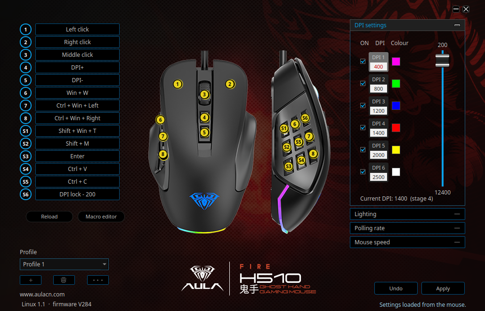

# AULA H510 for Linux

A native Linux (KDE/Qt) settings app for the **AULA H510 "Ghost Hand"** MMO gaming mouse
(SinoWealth `258a:0029`), laid out like the official Windows app.



## Features

- Remap all 14 buttons: mouse clicks, DPI up/down/cycle, multimedia keys, keyboard shortcuts, macros
- Macro editor: record keys, edit delays (up to 4095 ms), add mouse clicks; up to 10 macros on the mouse
- 6 DPI stages (200–12400) with per-stage colours
- Lighting effects, brightness, speed and colour
- USB polling rate (125–1000 Hz)
- Cursor speed and scroll speed (KDE settings for this mouse)
- Profiles saved on the computer: add, delete, rename, import, export, switch

Settings are written to the mouse's own memory, so they also work on other computers.

## Install

Requirements: Python 3 and PyQt6 (`sudo apt install python3-pyqt6` on Ubuntu/Kubuntu).

```bash
./install.sh
```

This installs a udev rule so your user can access the mouse (asks for sudo once) and adds
**AULA H510** to the application menu. You can also run `python3 aula_h510_app.py` directly.

## How it works

The protocol was checked against the official app (`OemDrv.exe`, run under Wine with its HID
traffic logged, plus disassembly) and libratbag's SinoWealth driver:

- Vendor interface (interface 1): feature report `0x05` (6-byte commands) and `0x04` (520-byte blocks)
- Read a block: `SET_FEATURE 05 <cmd> 00 00 00 00`, then `GET_FEATURE 0x04`
  (`0x11` settings, 131 bytes; `0x12` button map, 88 bytes)
- Write a block: send it back with byte 3 set to `size - 8`; unknown bytes are preserved
- DPI values are 1-based indexes into the official DPI table (not `(dpi-100)/100`, so
  Piper/libratbag shows the wrong values above 6100 DPI)
- Macros: `04 30 02 00 00 00 00 00 <slot> <count hi> <count lo>` followed by 3-byte events
  `[command | delay >> 8, delay & 0xFF, code]` (keys `0x50`/`0xD0`, mouse buttons `0x10`/`0x90`);
  a macro button entry is `70 <slot> <mode> <count>`

Files: `aula_device.py` (protocol), `aula_store.py` (profiles, macro library, KDE pointer settings),
`aula_macro_ui.py` (macro windows), `aula_h510_app.py` (main window).

## Artwork

The images in `assets/` come from the official AULA H510 installer and belong to AULA.
